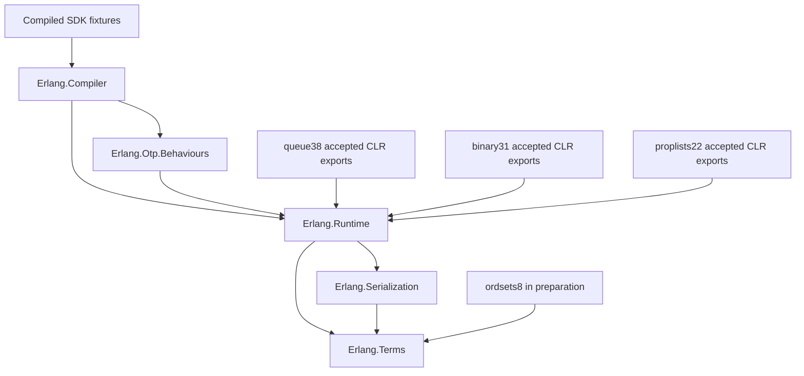
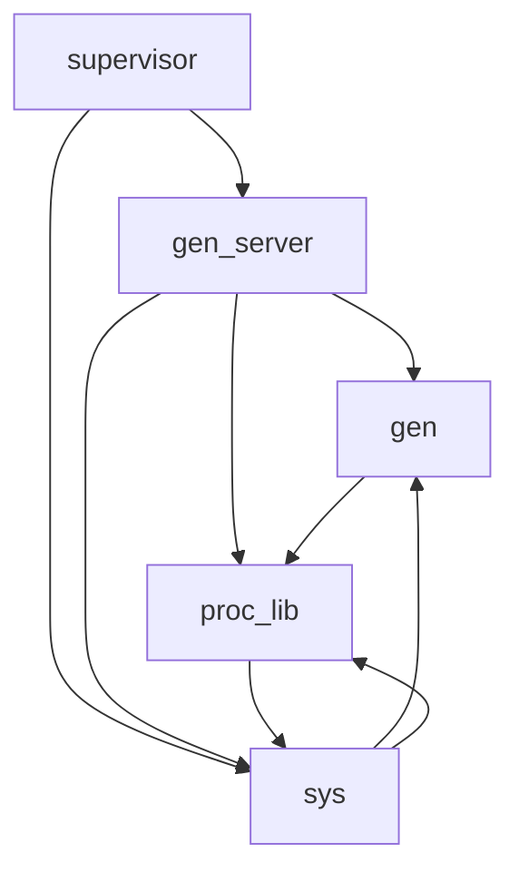

# Selected API dependencies

Part371 complete locally —2026-10-18. Implemented all21 ordsets APIs; delta+21 implemented/+7 complete source contracts/+31 tests. Totals699 APIs/114 complete/30 Known/555 pending across18 modules. Ordsets21/21 present,3 complete,18 dependency contracts pending; erlang351 present,20 complete,13 Known,318 pending. Original full21 CI39113248779 and final Main match2616/2616 strictly; erlang new packet4506/4506 and retained9846/9846 strictly. Final canonical7673/7673 tests passes in349.640s; metadata/package suffix54.343s passes11 integrations/two local packages/current and installed CLI equality over5 files. All7642 old ordered names and496 source guards are retained. First restricted canonical7657/7673 (16 native-port eacces) is preserved; identical DLLs pass outside sandbox, without port changes. Earlier accepted363–370 are published at67d0874d with exact-head CI39111694027 passing7642/11. Part371 publication/current-head CI is next. [Module status](MODULE_READINESS.md); [completion](validation/part-371/local-completion/README.md); [journal](changelog/0060.md).

Local documentation only, 2026-10-17; uncommitted and excluded from part362 publication. Source authority: OTP-29.1.1 `ad05823719d77c8faee87348ea39513d4e2f99c5`. This is a selected dependency map, not a complete OTP call graph or proof that every export must be implemented.

## Origin and verification

The earlier diagram exists as a text graph in [DEPENDENCY_PRIORITIES.md](DEPENDENCY_PRIORITIES.md), under “Dependency groups”. Its introduction is present in commit `ed2785a000ae8b1c520707df3224c2807c959bc3` (found by history search for “An arrow means”). Its old counts/priorities are historical. The Mermaid graphs below are a narrowed, code-checked rendering and current planning reconstruction, not an unchanged historical Mermaid artifact.

Solid arrows mean **left depends on / calls right**, not “implement left first”. Dashed arrows in the final graph mean only **proposed work order**. Nodes describe families/subsystems rather than full compatibility status. A cycle requires a coherent minimal contract group; it does not require every export of each module before any progress.

## Pure API and execution foundations

These foundation edges are checked project references, not claims that every pure operation uses scheduling or serialization at execution time. Queue operations use immutable tuples/Cons, integers and exceptions; binary access reuses `ErlangIoData.Binary`/`Part`; property lookup uses terms, exact equality and common exceptions. The proposed implementations are C# adaptations and need not call every module used by OTP's Erlang source. Native NIF loading/TLS is not a prerequisite for these pure-family implementations. Compilation and runtime source-function invocation are prerequisites for their compiled fixture gate. Original comparison separately requires an admitted pinned OTP runtime and independently executed matching fixtures.

## Selected OTP behaviour dependencies

These selected direct source calls were checked against `git show` at the exact pinned commit: `lib/stdlib/src/gen.erl` calls `proc_lib:start*`; `proc_lib.erl` calls `sys:terminate`; `sys.erl` calls `gen:call/reply` and `proc_lib:hibernate`; `gen_server.erl` calls `gen`, `proc_lib` and `sys`; `supervisor.erl` calls `gen_server:start_link/call/cast` and `sys:get_status`. This confirms the displayed edges, not all dynamic, conditional, error-path or distribution dependencies. Existing API presence in these modules does not establish complete lifecycle/protocol contracts. OTP `queue.erl` also uses `lists:split/reverse` and `erlang:error`; those selected source dependencies are satisfied differently inside the proposed CLR adaptation.

## Work order, not a dependency graph

Source review of queue/binary can overlap; the user has separately authorized the full 22-export proplists family local implementation/tests (20 missing plus two existing regressions), not family publication. Queue is not a semantic prerequisite for binary; serialization of their integration protects Root-owned shared files and the heavy-build gate. See [delivery packages](API_DELIVERY_PACKAGES.md) for exact MFAs, ownership and gates; execution authorization and actual results supersede the dated planning sequence. Native infrastructure uses its separate 24-row inventory and contributes zero new MFAs. wx/platform exports are potential scope, not an automatic requirement imposed by this graph.

Checked local implementation sources: [compiler project](../src/Erlang.Compiler/Erlang.Compiler.csproj), [behaviours project](../src/Erlang.Otp.Behaviours/Erlang.Otp.Behaviours.csproj), [runtime project](../src/Erlang.Runtime/Erlang.Runtime.csproj), [serialization project](../src/Erlang.Serialization/Erlang.Serialization.csproj), [CoreModules registration](../src/Erlang.Runtime.Core/Primitives/CoreModules.cs), [queue proposal](../artifacts/queue-core-proposal1/README.md), [binary proposal](../artifacts/binary-access-proposal1/README.md). Inventory inclusion/exclusion rules come from [Inventory.cs](../tools/Erlang.Tool/Inventory.cs); direct MFA presence tests/export come from [test coordinator](../tests/Erlang.Tests/Program.cs). No new build, original execution or compatibility classification is asserted by this documentation.

Generated families need a generator/input/platform-bridge split before assigning API work; the wx/OpenGL source example and external-input/license gaps are recorded in the delivery plan. The graph does not expand GUI scope.
